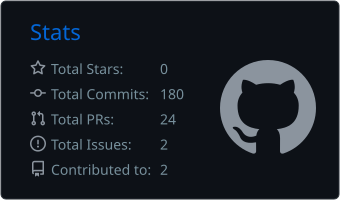
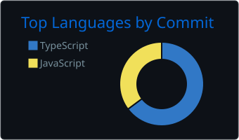

<h1 align="center">Nicolas Diaz 🤘</h1>
 

  

  

 
### 🥊 Ficha técnica del peleador
 
- **Categoría:** Desarrollo web, peso JavaScript
- **Guardia:** TypeScript, cuando quiero ganar por puntos y no por nocaut accidental en producción
- **Golpe favorito:** El `console.log` estratégico. Elegante no es, efectivo sí
- **Fuera del ring:** Boxeo de verdad (ahí los errores duelen más) y guitarra eléctrica a un volumen que mis vecinos no aprueban
- **Récord:** Invicto contra los bugs fáciles. De los otros mejor no hablemos
---
 
### 🏋️ En el ring ahora mismo: FitTracker
 
Una app para registrar entrenamientos y seguir el progreso, porque "creo que levanté más que la semana pasada" no es una métrica.
 
<!-- Ajustá esta descripción y el link al repo o la demo -->
<!--👉 [**Ver FitTracker**](https://github.com/nikodiaz/FitTracker) -->
 
---
 
### 🛠️ Equipo de combate
 

 
**¿Frameworks?** Los que pida la pelea. Hoy salen más rápido que los discos de Sabaton, así que prefiero entender bien los fundamentos y adaptarme.
 
---
 
### 🎸 Setlist mientras codeo
 
| Situación | Banda sonora |
|---|---|
| Mi primer merge a `main` sin revisar | **Megadeth** · *Symphony of Destruction* |
| Se cayó producción un viernes | **Iron Maiden** · *Run to the Hills* |
| Refactorizando código legacy | **Sabaton** · *The Last Stand* |
| Debuggeando a las 3 AM | **Powerwolf** · *Army of the Night* |
 
---
 
### 📊 Estadísticas del combate
 

  
  

  

Racha de contribuciones: más constante que mi jab. Por ahora.

---
 
### 📫 ¿Sparring, proyecto o charla sobre qué canción de Iron Maiden es mejor?
 

 
---
 

<b>🤘 Up the Irons! 🤘</b>

 
